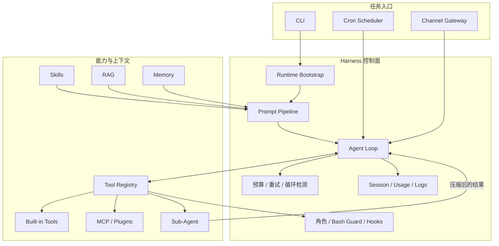

# Super Agent

Super Agent 是一个用 TypeScript 实现的 **AI Agent Harness 学习项目**。它关注的不是“如何调用一次大模型”，而是：当一个最小 Agent Loop 进入真实环境后，怎样围绕模型建立工具、上下文、记忆、多 Agent、安全、调度和可观测性等工程能力。

这个项目用六个支柱解释 Agent 系统：

1. Agent Loop
2. Tool System
3. Context Engineering
4. Memory
5. Multi-Agent
6. Harness Engineering

项目基于三个核心判断展开：

- **上下文是 Agent 最稀缺的资源**：关键不是给模型更多信息，而是在正确的时间给它正确的信息。
- **概率性决策交给模型，确定性边界交给工程系统**：模型可以决定下一步做什么，但权限、预算、并发、超时和熔断不能依赖模型自觉。
- **每个 Harness 组件都对应一个失败假设**：只有观察到模型无法独立处理的问题，才增加最小的工程组件来兜底。

> 当前仓库是架构学习与能力验证项目，不是已经完成生产化的通用 Agent 平台。README 会明确区分已实现能力、演示能力和尚未接入默认流程的能力。

## 从最小循环到 Harness

一个 Agent 的最小形态并不复杂：

```text
用户目标
   ↓
模型判断下一步
   ├─ 直接回答 → 结束
   └─ 调用工具 → 执行工具 → 把结果放回上下文 → 再次判断
```

真正困难的是循环之外的问题：模型可能重复调用同一个工具、把错误结果当成事实、加载过多工具定义、耗尽 Token、执行危险命令、在长任务中丢失上下文，或者在失败后无法恢复。

因此，生产级 Agent 不是“更长的 Prompt”，而是“模型 + Harness”。Harness 类似 Agent 的操作系统，负责循环控制、工具执行、上下文供给、权限、预算、并发、重试、持久化、调度和观测；模型则负责语言理解与不确定环境中的决策。

## 六大支柱

| 支柱 | 要解决的问题 | 核心原则 | 本项目实现 | 当前完成度 |
| --- | --- | --- | --- | --- |
| Agent Loop | 如何持续推理，又不无限运行 | 循环必须有确定性保险丝 | 流式循环、重复/无进展检测、重试、步数与 Token 上限 | 核心已实现 |
| Tool System | 如何把模型意图变成受控的外部动作 | 模型只表达意图，工程系统负责验证和执行 | Tool Registry、并发锁、角色过滤、Bash 风险分类、Hooks、延迟发现 | 核心已实现 |
| Context Engineering | 如何让模型在有限窗口里看到正确的信息 | Offload、Reduce、Retrieve、Isolate、Cache | Prompt Pipeline、工具结果截断、压缩、TTL、Tool Search、Skills、上下文视图 | 部分自动化 |
| Memory | 如何跨会话保留不能重新推导的信息 | 记忆是线索，不是事实 | Markdown 记忆、索引、BM25、Lint、Dream；RAG 混合检索 | 核心已实现 |
| Multi-Agent | 单个上下文装不下任务时如何拆分 | 拆 Agent 首先是拆上下文，不是角色扮演 | 父子 Sub-Agent、并发、深度、超时、结果回传 | 基础实现 |
| Harness Engineering | 如何约束、观测、调度和恢复 Agent | 每个组件对应可观测的失败模式 | Hooks、角色权限、用量统计、Session、Cron、Channel、Plugin | 实验性实现 |

## 系统架构



## 1. Agent Loop：让推理可持续，也可停止

Agent Loop 的价值不是简单地重复调用模型，而是把模型的概率性行为包在确定性的状态机里。每一轮都需要回答三个问题：

1. 模型是已经给出最终答案，还是要求调用工具？
2. 新一轮是否产生了进展？
3. 当前任务是否仍在预算和安全边界内？

本项目的 `src/agent/loop.ts` 使用 AI SDK 的流式输出驱动循环。文本直接输出，工具调用和工具结果进入消息历史，然后开始下一轮推理。循环外设置了多层保险丝：

- 最多 15 个主循环步骤。
- 单次任务 50,000 Token 预算，并在 90% 时告警。
- 对 429、5xx、超时和网络错误最多重试 3 次，使用指数退避和随机抖动。
- 对“相同工具 + 相同参数”“A/B 乒乓调用”“相同结果且没有进展”建立滑动窗口检测。
- 警告级重复会要求模型换思路，严重重复由 Harness 直接停止。

对应代码：`src/agent/loop.ts`、`src/agent/detection.ts`、`src/agent/retry.ts`。

当前边界：Token 和步数预算是代码常量，还没有按任务动态分配；主循环没有统一的外部取消信号，也没有单独的金额成本熔断器。

## 2. Tool System：模型提出意图，系统执行动作

模型不会真的执行函数。它只根据工具名称、描述和 JSON Schema 生成结构化调用意图，真正的执行发生在 Harness 中。因此，工具系统是模型与真实世界之间的安全边界。

理想的工具执行管线是：

```text
Schema 校验
  → 语义校验
  → 输入规范化
  → Pre Hook
  → 权限检查
  → 并发调度
  → 执行
  → Post Hook
  → 结构化结果
```

本项目通过 `src/tools/registry.ts` 统一管理内置工具、MCP 工具和插件工具。当前实际执行链包括：

```text
角色与 Profile 过滤
  → AI SDK Schema 校验
  → Bash 风险分类
  → Pre Hook
  → 共享锁 / 独占锁
  → 工具执行
  → 结果截断
  → Post Hook
  → 返回模型
```

只读且并发安全的工具可以并行执行，写操作进入独占区，降低多个工具同时修改状态的风险。`owner`、`collaborator`、`guest` 三类角色决定模型能看到哪些工具；危险 Bash 命令会在执行前被拒绝。

### 为什么需要延迟加载

工具越多，模型不一定越强。每个工具的名称、说明和 Schema 都会占用上下文，还会增加选错工具的概率。因此项目用 `profile` 控制稳定工具集，用 `shouldDefer` 隐藏低频工具，并通过 `tool_search` 按需暴露完整定义。

当前 `tool_search` 是按精确工具名发现，不是语义 Tool Search。它验证了 Deferred Loading 的执行路径，但还没有实现大规模工具目录的检索排序。

### Skills、MCP 与 Plugins

三者解决的是不同层面的问题：

| 扩展方式 | 本质 | 适合承载 | 本项目状态 |
| --- | --- | --- | --- |
| Skills | 知识与工作方法 | 最佳实践、流程、领域约束 | 从 `.skills/*/SKILL.md` 加载，手动激活后注入 Prompt |
| MCP | 标准化能力协议 | 外部服务、远程 API、有状态连接 | 默认注册 Mock GitHub 工具；另有真实 Stdio Client |
| Plugins | 运行时扩展单元 | 生命周期、配置和动态工具注册 | 已有 Plugin Manager 与 Supabase 示例 |

可以把两者的分工概括为：**Skills 负责“知道怎么做”，MCP 负责“能够做到”**。MCP 工具同样经过命名空间、权限、Hook、并发和结果截断管线，不应因为来自外部服务而获得特权。

当前边界：Registry 还没有独立的业务语义校验和通用输入规范化层；MCP 返回内容也没有专门的 Prompt Injection 隔离机制。

## 3. Context Engineering：管理模型真正能看到的世界

上下文不是聊天记录的同义词。系统提示词、工具定义、工具结果、会话历史、记忆、RAG 片段和 Skill 都在争夺同一个窗口。Context Engineering 的目标是控制信息何时进入、保留多久、以什么粒度存在。

可以从五个维度理解：

| 维度 | 设计问题 | 本项目映射 |
| --- | --- | --- |
| Offload | 哪些信息不必常驻窗口 | Memory 文件、Session JSONL、RAG Store |
| Reduce | 哪些历史可以压缩或清理 | 工具结果截断、Microcompact、LLM 摘要、TTL Prune |
| Retrieve | 需要时怎样找回来 | BM25 Memory、RAG、文件工具、Tool Search |
| Isolate | 哪些子任务不应污染主上下文 | Sub-Agent 独立消息历史 |
| Cache | 哪些稳定前缀不应重复计算 | 用量模块记录 cache read/write；Mock 模型可演示命中 |

实践上的优先级是：**先 Offload，再保证稳定前缀便于 Cache，然后 Reduce；上下文仍然过载时再 Isolate；Retrieve 贯穿整个过程。**

### Just-In-Time Context

项目尽量保存“索引”而不是把全部内容提前塞给模型：

- Memory 默认注入索引，需要时再读取具体文件。
- Skills 先暴露名称、描述和适用场景，激活后才注入正文。
- Deferred Tools 先暴露摘要，发现后才加入完整 Schema。
- RAG 只告诉模型知识库规模和来源，具体片段通过搜索获取。

这与代码探索中的渐进成本原则一致：先用 `glob` 确认范围，再用 `grep` 定位，最后用 `read_file` 读取必要内容。

对应代码：`src/context/prompt-builder.ts`、`src/context/prompt-pipes.ts`、`src/context/defense.ts`、`src/context/compressor.ts`、`src/context/tool-output.ts`。

当前边界：工具结果的基础截断已在 Registry 自动执行，但完整的 Context Defense 目前只通过 `sim` 和 `defend` 命令显式验证，尚未自动挂入每轮 Agent Loop；项目能记录提供商返回的 Cache 用量，但没有实现独立的 Prompt Cache 服务。

## 4. Memory 与 RAG：保留线索，按需重建事实

会话上下文和长期记忆不是一回事：Session 保存一次运行中的原始消息，Memory 保存跨会话仍有价值、并且无法从当前代码和文档重新推导的信息。

适合进入 Memory 的内容包括用户偏好、明确反馈、项目决策和外部参考。不应该保存能从代码、Git 或已有文档直接查询的事实，因为这些快照会随着项目变化而过期。

项目采用可读、可审计的 Markdown 文件方案：

- `.memory/MEMORY.md` 只保存索引，具体内容拆到独立文件。
- 索引最多 200 行，单文件读取最多 4,000 字符，避免记忆无限膨胀。
- BM25 用于关键词检索，适合短文本和中英文混合记忆。
- `memory lint` 检查过期路径、长期未使用和重复名称。
- `/dream` 驱动 Agent 合并、更新或删除问题记忆。

最重要的使用规则是：**记忆是线索，不是事实。** 当记忆提到文件、函数或项目状态时，行动前应重新用文件工具或 Git 验证；当前观察与旧记忆冲突时，以当前观察为准并更新记忆。

### RAG 不是“向量搜索”的别名

一个可用的 RAG 流程包含：

```text
Load → Chunk → Embed → Store → Retrieve → Rerank / Deduplicate
```

语义相似不等于任务相关，所以 `src/rag/search.ts` 同时计算向量相似度和关键词相关度，按 70% / 30% 合并候选，再用 MMR 减少重复结果。启动时 `docs/` 下的 Markdown 会自动切片并导入。

对应代码：`src/memory/`、`src/rag/`、`src/tools/memory-tools.ts`、`src/tools/rag-tools.ts`。

当前边界：默认运行时使用内存 `VectorStore`，重启后重新导入；`SqliteVectorStore` 已实现 SQLite、FTS5 和向量存储，但没有接入默认启动路径。当前检索也没有 Query Rewrite、Cross-Encoder Reranker 和时间衰减。

## 5. Multi-Agent：用额外上下文换取任务隔离

拆分 Agent 的首要原因不是给不同模型扮演“产品经理”“程序员”等角色，而是把互相独立、会消耗大量上下文的子任务移出主窗口。父 Agent 只提供任务目标，子 Agent 在自己的消息历史中探索，最后把压缩后的结果返回父上下文。

```text
父 Agent 上下文
  ├─ 子任务 A → 私有上下文 → 结果摘要 ┐
  ├─ 子任务 B → 私有上下文 → 结果摘要 ├─ 回到父上下文
  └─ 子任务 C → 私有上下文 → 结果摘要 ┘
```

`src/agents/` 实现了父子式 Sub-Agent：

- 子 Agent 创建独立消息历史，但复用模型和 Tool Registry。
- `spawn_agent` 不会继续暴露给子 Agent，避免递归派生。
- 支持并行派发、最大并发数、最大深度和超时取消。
- 子 Agent 最后一轮强制停止工具调用并返回文字结论。
- 父 Agent 只接收结果文本，而不是完整的子 Agent 轨迹。

拆分本身有通信、延迟、调试和失败成本。只要单个 Agent 的上下文仍能完成任务，就不应为了“看起来像团队”而拆分。

当前边界：这是 Parent-Child 模式，不是拥有共享任务板、点对点通信和协商机制的 Swarm；也没有为写操作提供 Git Worktree 文件系统隔离。多个子 Agent 共享同一工作目录，适合并行调查，不适合无约束地并行修改同一文件。

## 6. Harness Engineering：把失败变成可控制的系统行为

Harness 不应靠功能堆叠演进。更合理的过程是：观察一次失败，提出模型能力假设，加入最小组件，验证它是否降低失败率；模型升级后再重新评估这个组件是否仍有价值。

本项目当前覆盖四类 Harness 责任：

| 责任 | 当前实现 | 仍缺少什么 |
| --- | --- | --- |
| 安全与权限 | 角色工具过滤、Bash 风险分类、Pre/Post Tool Hooks | 用户确认流、细粒度资源权限、外部内容隔离 |
| 成本与预算 | Token 预算、步数上限、Usage JSONL、Cache 用量展示 | 金额熔断、任务级动态预算、完整成本面板 |
| 可观测性 | 流式步骤日志、工具调用预览、Session transcript、`/context`、`/usage` | Trace/Span、耗时与成功率聚合、OpenTelemetry |
| 调度与接入 | Cron、CLI、Channel Gateway、飞书 Channel | 崩溃恢复、任务队列、分布式执行 |

Hook 是在关键节点插入确定性行为的轻量方式。项目当前实现的是进程内 Pre/Post Tool 回调，可用于阻止或修改工具输入、修改输出和记录审计信息；它还不是覆盖会话、压缩、Sub-Agent 和工作区生命周期的通用外部 Hook 系统。

SessionStore 会把消息追加到 `.sessions/*.jsonl`，但默认启动流程不会自动加载旧会话。也就是说，仓库已经具备 transcript 存储原语，尚未完成可靠的 resume 与崩溃恢复闭环。

## 一次请求的完整生命周期

```text
1. CLI / Channel / Cron 接收任务
2. Command Dispatcher 优先处理本地管理命令
3. Prompt Pipeline 组装规则、工具摘要、Memory、RAG、Skills 和会话信息
4. Tool Registry 根据角色、Profile 和 Deferred 状态确定模型可见工具
5. Agent Loop 调用模型并消费流式输出
6. 工具调用经过风险检查、Hook、并发调度、执行和结果截断
7. 工具结果回到消息历史，模型继续判断下一步
8. 循环检测、重试、Token 预算和最大步数决定继续或停止
9. Session 与 Usage 将消息和用量追加到本地 JSONL
```

## 当前架构边界

为了区分“仓库里有代码”和“默认流程已使用”，当前状态如下：

| 能力 | 默认流程状态 |
| --- | --- |
| Agent Loop、工具执行、循环检测、重试、Token 预算 | 已接入 |
| Tool Registry、角色过滤、Bash Guard、Pre/Post Hooks | 已接入 |
| Memory 索引注入、RAG 提示与搜索、Skill 手动激活 | 已接入 |
| `docs/` 自动导入 | 已接入，使用内存向量库 |
| Context Defense 全量压缩与 TTL 清理 | 仅 `sim` / `defend` 显式触发 |
| Session JSONL | 自动写入，不自动回放 |
| SQLite RAG Store | 已实现，默认未接线 |
| 真实 MCP Server | 有 Stdio Client；默认使用 Mock GitHub MCP |
| Sub-Agent | 已接入 Parent-Child 模式，无 Swarm / Worktree 隔离 |
| Plugins | Manager 已接入，示例插件默认关闭 |
| 飞书 Channel | 配置启用后接入 |
| `app/`、`sample-project/` | 演示内容，不属于核心运行时 |

## 目录结构

```text
.
├── src/
│   ├── agent/       # Agent Loop、重试与循环检测
│   ├── tools/       # Tool Registry、内置工具、MCP 与 Tool Search
│   ├── context/     # Prompt Pipeline、压缩、防线与上下文视图
│   ├── memory/      # Markdown Memory、BM25 与健康检查
│   ├── rag/         # Chunk、Embedding、混合检索与存储
│   ├── agents/      # Sub-Agent 调度与运行记录
│   ├── security/    # 角色、Hooks 与 Bash 风险分类
│   ├── skills/      # Skill 加载和渐进式注入
│   ├── plugins/     # Plugin 生命周期与示例插件
│   ├── channels/    # 外部消息接入
│   ├── cron/        # 定时任务调度与持久化
│   ├── session/     # 会话 transcript
│   └── usage/       # Token、Cache 与成本记录
├── .skills/         # 本地 Skills
├── docs/            # 启动时导入的知识库文档
├── app/             # 多文件应用生成演示
├── sample-project/  # 代码分析演示输入
└── super-agent.config.json
```

## 快速开始

环境要求：Node.js 24、pnpm。

```bash
pnpm install
pnpm run init
pnpm start
```

`pnpm run init` 会生成配置，并在输入凭据时写入本地 `.env`。输入 `exit` 会停止 CLI、Cron、Channel 和插件。

当 `super-agent.config.json` 中的 `model.apiKey` 为空字符串时，运行时使用内置 Mock 模型：

```json
{
  "model": {
    "apiKey": ""
  }
}
```

## 配置

主配置位于 `super-agent.config.json`。敏感信息可以通过 `${ENV_NAME}` 从 `.env` 或进程环境变量注入：

| 环境变量 | 用途 |
| --- | --- |
| `OPENAI_API_KEY` | OpenAI 兼容模型服务凭据 |
| `OPENAI_BASE_URL` | 自定义 OpenAI 兼容 API 地址 |
| `ALIYUN_API_KEY` | DashScope Embedding 凭据 |
| `TAVILY_API_KEY` / `SERPER_API_KEY` | Web 搜索后端 |
| `FEISHU_APP_ID` / `FEISHU_APP_SECRET` | 飞书 Channel |
| `SUPABASE_URL` / `SUPABASE_KEY` | Supabase 示例插件 |

不要提交 `.env`。未解析的 `${ENV_NAME}` 会保留原值并输出警告；需要使用 Mock 模型时，应把 `model.apiKey` 明确设置为空字符串。

## 常用命令

| 命令 | 作用 |
| --- | --- |
| `/context`、`/usage` | 查看上下文构成和 Token、Cache、成本统计 |
| `/memory`、`/memory search <query>` | 查看或搜索长期记忆 |
| `/dream` | 检查并整理记忆库 |
| `/rag`、`ingest <path>` | 查看知识库或导入文档 |
| `/skill list`、`/skill load <name>` | 查看和激活 Skills |
| `/plugin`、`/plugin load <name>` | 管理插件及动态工具 |
| `/agents` | 查看 Sub-Agent 运行记录 |
| `/cron` | 查看定时任务和运行记录 |
| `/role [owner\|collaborator\|guest]` | 查看或切换工具权限角色 |
| `/hooks`、`/channel` | 查看 Hooks 和消息通道 |
| `sim`、`defend` | 注入长对话并显式验证 Context Defense |

## 本地运行数据

以下文件由运行时按需创建，并已加入 `.gitignore`：

```text
.memory/      # 长期记忆
.sessions/    # 会话 transcript
.cron/        # 定时任务及日志
.usage/       # Token 与成本记录
knowledge.db* # 可选 SQLite 知识库
```

## 验证

项目使用 TypeScript 严格模式进行静态检查：

```bash
pnpm exec tsc --noEmit
```
